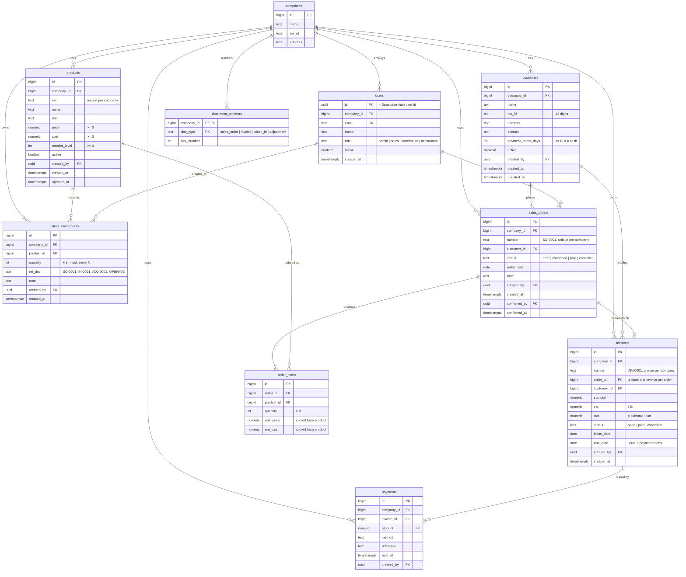

# Siam Bean Co. Mini ERP

One system where sales, stock, invoices and a dashboard share one database, for a small coffee-bean distributor in Bangkok. Built for CU FDE3.

**Live app:** https://_fill-in_.vercel.app · **API docs:** https://_fill-in_.vercel.app/docs

| Layer    | Tech |
| -------- | ---- |
| Frontend | React + TypeScript + Vite (`frontend/`) |
| Backend  | Python FastAPI + SQLAlchemy, managed with uv (`backend/`) |
| Database | Supabase Postgres, Supabase Auth for logins |
| Hosting  | Vercel (one project for the frontend, one for the backend), see [ADR 0003](docs/adr/0003-deploy-on-vercel.md) |

## The problem

Siam Bean takes orders by LINE and phone, retypes them into a spreadsheet, keeps stock in another sheet and writes invoices in Word. The owner's words:

1. "Stock in the sheet is always wrong." → stock is the sum of movements; confirming an order moves it automatically
2. "Each invoice takes me an hour and the numbers get mixed up." → confirming issues INV-000x with 7% VAT, numbered by the server
3. "I never know who still owes me money." → open invoices on the dashboard and the Accounting screen
4. "Sales sometimes promise beans we don't have." → an order with too little stock cannot be confirmed
5. "Anyone can change anything in the spreadsheet." → four roles, checked by the server on every request

## Demo accounts

Password for every account: **`SiamBean2026!`** (the login page has one-tap buttons for each role).

| Role       | Name          | Email | Can do |
| ---------- | ------------- | ----- | ------ |
| Admin      | Khun Somchai  | `admin@siambean.example.com` | Everything, including users and prices |
| Sales      | Nok           | `sales@siambean.example.com` | Customers, create and confirm sales orders, view invoices |
| Sales      | Ploy          | `ploy@siambean.example.com` | Same as Nok |
| Warehouse  | Lek           | `warehouse@siambean.example.com` | Stock-in, adjustments, view products |
| Accountant | Fon           | `accountant@siambean.example.com` | Invoices and payments, view products and customers |
| Admin of a 2nd company | Khun Malee | `bakery@chiangmaibakery.example.com` | Chiang Mai Bakery: proves the data is separated |

## User stories

| Story | Status | Where to see it | Tests |
| ----- | ------ | --------------- | ----- |
| **US-1** Sales order → invoice: 170 kg ARB-1KG, confirm 20 kg for Café Lune → 150 kg and INV-0001 = 9,000 + 630 VAT = 9,630 THB; too little stock → "Not enough stock for ARB-1KG", nothing changes | ✅ Done | Sales orders → New → Confirm | `test_orders.py` |
| **US-2** Low stock: product below reorder level shows a badge and counts on the dashboard (ROB-1KG starts at 35 < 40) | ✅ Done | Products, Dashboard | `test_stock.py`, `test_dashboard.py` |
| **US-3** Roles: Sales opening Accounting → access-denied page + API 403; Warehouse calling confirm-order API → 403; Admin → loads | ✅ Done | log in as Sales, open `/accounting` | `test_roles.py` (whole permission matrix) |
| **US-4** Payment: full payment of 9,630 on INV-0001 → Paid, open receivables drop by 9,630 | ✅ Done | Accounting → invoice → Record payment | `test_payments.py` |
| **US-5** Search: 200 customers, type part of a name → filters in < 1 s, max 20 rows per page | ✅ Done | Customers, customer picker on New order | `test_customers.py` |

### Minimum requirements

- [x] Login with roles, server returns 403 for the wrong role
- [x] Products and customers: create, list, edit, deactivate, required fields checked, sample data loaded
- [x] Stock: stock-in form, stock goes down on confirm, low-stock badge
- [x] Sales order → invoice INV-000x with the same lines and total + 7% VAT; too little stock = error, nothing changes
- [x] Payments: a full payment marks the invoice Paid
- [x] Dashboard: sales today, open invoices, low-stock count, stock value, all computed live
- [x] Relational database: the ER diagram below matches the tables in `backend/erp/models.py`
- [ ] Deployed: _tick after checking the URL on a phone on mobile data_

### Stretch goals (bonus)

1. **Printable PDF invoice:** the invoice page prints as an A4 tax invoice with company header, both tax IDs and VAT (Print / Save PDF button).
2. **Multi-tenancy:** every business table has `company_id` and every query filters by the user's company. Log in as the Chiang Mai Bakery admin: none of Siam Bean's products, customers, orders or invoices are visible, Siam Bean ids return 404, and the bakery's numbering starts again at SO-0001 / INV-0001. Tested in `test_tenancy.py`.

## Business rules and where they are enforced

| Rule (from the scenario) | Enforced in |
| --- | --- |
| VAT 7%, price without VAT on the line, invoice stores subtotal / VAT / total | `erp/rules.py` `vat_for`, `invoices` table + `CHECK (total = subtotal + vat)` |
| Stock never negative; too little stock → nothing changes | `confirm_order` checks with row locks, one transaction ([ADR 0001](docs/adr/0001-confirm-order-in-one-transaction.md)); adjustments checked the same way |
| On hand = sum of movements | no quantity column on `products`; `stock_movements.quantity <> 0` |
| Sequential numbers, never reused | `document_counters`, incremented inside the same transaction |
| Confirm creates movements and invoice together | `POST /orders/{id}/confirm`, single commit |
| Price copied onto the line | `order_items.unit_price`, `unit_cost` |
| Deactivate, never delete | no DELETE endpoints; `active` flag on products, customers, users |
| Roles on the server | `Depends(require(...))` on every endpoint ([ADR 0002](docs/adr/0002-supabase-auth-with-roles-in-our-users-table.md)) |
| Price ≥ 0, quantity > 0, SKU unique, tax ID required | Pydantic validators + `CHECK` / `UNIQUE` constraints |

## Database (ER diagram)

These are the real tables, created by `backend/seed.py` from `backend/erp/models.py`.



Design notes: products have no quantity column (on hand = `SUM(stock_movements.quantity)`); the order line and the invoice keep their own prices and totals so price changes never rewrite history; every table has row level security enabled with no policy, because only FastAPI talks to the database.

## Project structure

```
siam-bean-erp/
├── GLOSSARY.md                 domain language (from /grill-with-docs)
├── CLAUDE.md                   agent instructions + skills config
├── docs/
│   ├── scenario.md             the brief (input to the agent)
│   ├── demo-script.md          the 10-minute Class 4 demo, step by step
│   ├── adr/                    decisions: transaction, auth, hosting
│   └── agents/                 issue tracker + domain docs config
├── .scratch/mini-erp/
│   ├── spec.md                 spec (from /to-spec): decisions, permission matrix, API
│   └── issues/01-…09-*.md      tickets (from /to-tickets)
├── backend/
│   ├── main.py                 entry point (Vercel + fastapi dev)
│   ├── seed.py                 create tables, demo logins and sample data
│   ├── erp/                    models, rules, auth, routers/
│   └── tests/                  pytest, written before the code
└── frontend/src/               api.ts, auth.tsx, pages/, components/
```

## Running locally

You need [uv](https://docs.astral.sh/uv/), Node.js 20+ and a Supabase project.

```bash
# 1. Backend
cd backend
cp .env.example .env        # fill in DATABASE_URL, SUPABASE_URL, keys (never commit .env)
uv run seed.py              # creates tables, demo logins and sample data
uv run fastapi dev main.py  # http://localhost:8000/docs

# 2. Frontend (new terminal)
cd frontend
cp .env.example .env.local  # VITE_API_URL=http://localhost:8000
npm install
npm run dev                 # http://localhost:5173
```

**Reset before the demo:** `uv run seed.py --reset` drops every ERP table and reloads the sample data, so ARB-1KG is back at 170 kg and the next invoice is INV-0001.

## Tests

```bash
cd backend
uv run pytest                                   # 155 tests, in-memory SQLite, no setup
TEST_DATABASE_URL=postgresql://… uv run pytest  # same tests on an EMPTY throwaway Postgres (drops tables!)
```

The tests were committed before the implementation (see the first commit). `tests/test_roles.py` checks every cell of the permission matrix in the spec.

## Deployment (Vercel + Supabase)

1. **Supabase:** create a project (region Singapore). Copy the *Transaction pooler* connection string (port 6543), the project URL, the publishable key and the secret key into `backend/.env`, then run `uv run seed.py` once from your laptop.
2. **Backend on Vercel:** New Project → import the repo → Root Directory `backend` → framework FastAPI. Environment variables: `DATABASE_URL`, `SUPABASE_URL`, `SUPABASE_PUBLISHABLE_KEY`, `SUPABASE_SECRET_KEY`, `ALLOWED_ORIGINS` (the frontend URL). Check `https://<backend>.vercel.app/health`.
3. **Frontend on Vercel:** New Project → same repo → Root Directory `frontend` → framework Vite. Environment variable: `VITE_API_URL=https://<backend>.vercel.app`. `vercel.json` rewrites every path to `index.html`.
4. Put the frontend URL into the backend's `ALLOWED_ORIGINS` and redeploy the backend.
5. Open the frontend URL on a phone using mobile data, log in as each role.

Every merge to `main` redeploys both projects.

## API

Interactive docs at `/docs` on the backend. Summary (full table with roles in the [spec](.scratch/mini-erp/spec.md#api)):

`POST /auth/login` · `GET /me` · `GET /dashboard` · `GET|POST /products` · `PATCH /products/{id}` · `GET /products/{id}/movements` · `GET|POST /customers` · `PATCH /customers/{id}` · `GET|POST /stock/movements` · `GET|POST /orders` · `GET|PUT /orders/{id}` · `POST /orders/{id}/confirm` · `POST /orders/{id}/cancel` · `GET /invoices` · `GET /invoices/{id}` · `POST /invoices/{id}/payments` · `GET /payments` · `GET|POST /users` · `PATCH /users/{id}`

## Team: who did what

| Member | Student ID | GitHub | Module owned | Tickets |
| ------ | ---------- | ------ | ------------ | ------- |
| _name_ | _id_ | _user_ | Login and dashboard | 01, 07, 08 |
| _name_ | _id_ | _user_ | Master data | 02, 03 |
| _name_ | _id_ | _user_ | Sales and invoices | 05, 06, 09 |
| _name_ | _id_ | _user_ | Stock | 04 |
